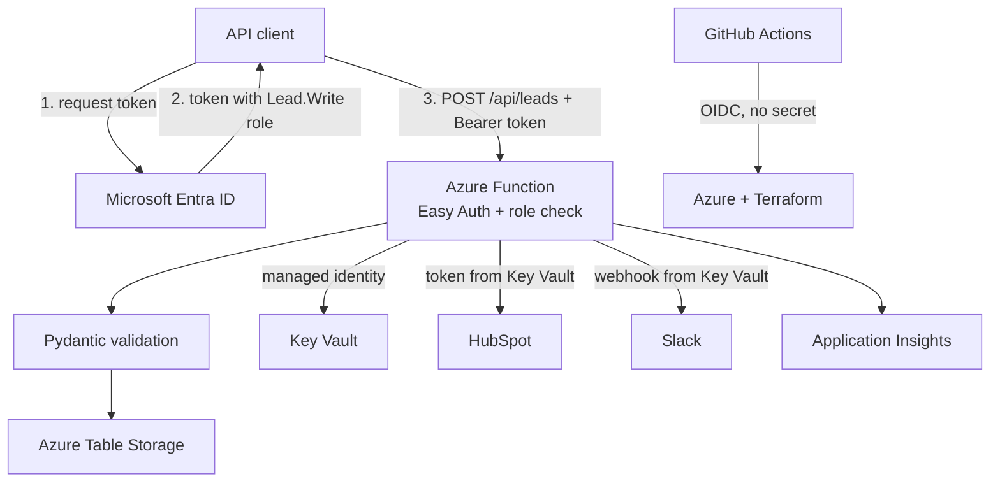
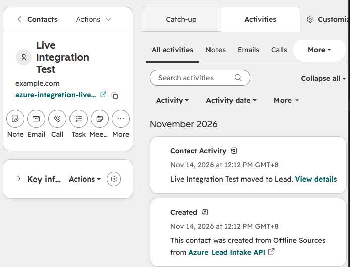
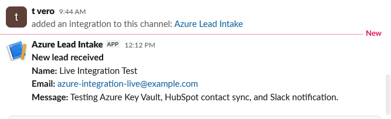
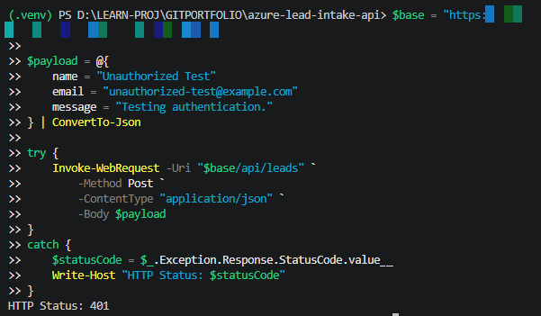

# Azure Lead-Intake API

A small serverless API on Azure that accepts sales leads from authenticated callers, stores them, and forwards them to HubSpot and Slack. The application infrastructure is defined in Terraform and checked by GitHub Actions.

[](https://github.com/tvero1011/azure-lead-intake-api/actions/workflows/ci.yml)
[](https://github.com/tvero1011/azure-lead-intake-api/actions/workflows/codeql.yml)

> **Status:** portfolio project built to learn and demonstrate Azure security and DevOps practices. It uses sample data only and is not a production system. Application resources are destroyed between sessions to keep cost near $0.

**Stack:** Python 3.11 · Azure Functions (Flex Consumption) · Table Storage · Key Vault · Entra ID · Application Insights · Terraform · GitHub Actions (OIDC) · Pydantic · pytest

## Contents

[What this project demonstrates](#what-this-project-demonstrates) ·
[Architecture](#architecture) ·
[API](#api) ·
[Security design](#security-design) ·
[Proof it works](#proof-it-works) ·
[Infrastructure](#infrastructure-terraform) ·
[CI/CD](#cicd) ·
[Monitoring](#monitoring) ·
[Evidence](#evidence) ·
[Testing](#testing) ·
[Cost](#cost) ·
[Try it](#try-it) ·
[Configuration](#configuration) ·
[Deploy](#deploy) ·
[Design decisions](#design-decisions) ·
[Known limitations](#known-limitations-and-next-steps) ·
[What I learned](#what-i-learned)

## What this project demonstrates

- **Identity-first security:** callers authenticate with Microsoft Entra ID, the Function reaches Azure services with a managed identity, and GitHub deploys with OIDC. No API keys, storage keys, or stored Azure passwords.
- **Infrastructure as code:** Azure Functions (Flex Consumption), Storage, Key Vault, Application Insights, alerts, RBAC and policy guardrails, all in Terraform. A few pieces are manual on purpose (see [What is not in Terraform](#what-is-not-in-terraform)).
- **CI/CD with guardrails:** pull requests never log in to Azure. Deployment is a manual workflow behind a protected `production` environment that needs a reviewer.
- **Honest engineering:** a CodeQL finding was fixed rather than dismissed, and the known gaps are listed at the end of this README.

## Architecture



### Request flow

1. The caller gets an access token from Entra ID (client credentials flow) for the API.
2. The caller sends `POST /api/leads` with the token.
3. **Easy Auth** validates the token. A missing or invalid token gets `401` before any code runs.
4. The application checks that the token carries the `Lead.Write` role. Without it, `403`.
5. Pydantic validates the payload. Bad input gets `422` with a field-level message.
6. The lead is saved to Table Storage. If saving fails, the API returns `503` and does not call any external service.
7. For a **new** lead, a Slack notification is sent. HubSpot gets an upsert by email.
8. The sync result is recorded on the lead as `crm_status` (`pending`, `synced` or `failed`). A downstream failure never loses the lead.

## API

| Method | Path | Auth | Purpose |
|---|---|---|---|
| GET | `/api/health` | None (excluded from Easy Auth) | Health check |
| POST | `/api/leads` | Entra token with `Lead.Write` role | Submit a lead |

Example request body:

```json
{
  "name": "Jane Smith",
  "email": "jane@example.com",
  "message": "Interested in your services."
}
```

Validation rules: `name` 2 to 100 characters, `email` a valid address up to 254 characters (stored in lower case), `message` 5 to 2000 characters. Extra spaces are trimmed.

| Status | Meaning | How it is verified |
|---|---|---|
| 200 | Health check OK, or lead accepted (`"status": "accepted"`) | Live, screenshots 04, 05, 14 |
| 401 | Missing or invalid token | Live, screenshot 15 |
| 403 | Valid token without the `Lead.Write` role | Automated tests (`tests/test_auth.py`) |
| 422 | Invalid payload, for example missing email | Live, screenshot 17 |
| 503 | Lead could not be saved | By design (see `app/function_app.py`), not covered by a test yet |

Validation response for a missing email:

```json
{
  "error": "Lead validation failed.",
  "details": [{ "field": "email", "message": "Field required" }]
}
```

Leads use `PartitionKey = leads` and `RowKey = email`, so sending the same email again updates the name and message instead of creating a duplicate. Saving does not reset `crm_status` to `pending`. After the update, the HubSpot sync for that request writes a fresh `crm_status` (`synced` or `failed`).

## Security design

| Control | How it is done |
|---|---|
| Caller authentication | Entra ID through App Service authentication (Easy Auth), unauthenticated requests get `401` |
| Caller authorization | The API app defines a `Lead.Write` app role. The code checks the role claim and returns `403` without it |
| No storage keys | Storage account has shared key access disabled. The Function uses its managed identity for Table and Blob access |
| Secrets | HubSpot token and Slack webhook live in Key Vault (RBAC mode). They are set by hand with `az keyvault secret set`, never through Terraform, so they never enter state |
| Least-privilege roles | The Function identity has Key Vault Secrets User, Storage Table Data Contributor, and narrowly scoped storage and monitoring roles |
| Pipeline login | GitHub Actions uses OIDC with a federated credential tied to the `production` environment. No Azure password is stored in GitHub |
| Pull requests | CI runs on pull requests but has no Azure login step and uses no deployment credentials |
| Safe logging | Structured JSON logs with a correlation ID. Only the email *domain* is logged, never the full address or any secret |
| Scanning | Gitleaks pre-commit hook (also run in CI), CodeQL, and Dependabot for Actions, pip and Terraform |
| Guardrails | Azure Policy on the application resource group: allowed locations and a required `project` tag |

## Proof it works

A lead sent with an Entra token reaches HubSpot and Slack, and a request without a token is rejected. All 17 screenshots are listed in [Evidence](#evidence).

<table>
  <tr>
    <td></td>
    <td></td>
    <td></td>
  </tr>
  <tr>
    <td align="center">HubSpot contact created</td>
    <td align="center">Slack notification</td>
    <td align="center">No token, HTTP 401</td>
  </tr>
</table>

## Infrastructure (Terraform)

There are two Terraform configurations so the state backend never depends on the resources it manages:

| Folder | Purpose |
|---|---|
| `bootstrap/` | Resource groups and Azure Policy assignments (allowed locations, required tag) |
| `infra/` | Application resources, using a remote `azurerm` backend with Entra ID authentication |

The remote state storage account was created manually in the portal. I removed storage provisioning from the bootstrap on purpose so that no storage credentials pass through Terraform.

Main resources in `infra/`:

| Resource | Notes |
|---|---|
| Azure Functions, Flex Consumption (FC1) | Python 3.11, scale limited to 1 instance, no always-ready instances configured |
| Storage account | Standard LRS, TLS 1.2, no public blobs, shared key access disabled, `Leads` table, private deployment container |
| User-assigned managed identity | Used for storage, Key Vault and Application Insights access |
| Key Vault | Standard tier, RBAC authorization, purge protection off so the environment can be destroyed and recreated |
| Log Analytics + Application Insights | 30 day retention, telemetry sent with managed identity authentication |
| Monitoring | Email action group, failed-requests metric alert, Activity Log alerts for Key Vault deletion and role assignment changes, and a simple portal dashboard (one text tile that points to the saved queries, no charts yet) |

### What is not in Terraform

These parts are manual on purpose or not automated yet:

- the Terraform state storage account and its `tfstate` container
- the Entra ID app registrations (API app, caller app, pipeline app) and the pipeline's role assignments
- the Key Vault secrets (`hubspot-access-token`, `slack-webhook-url`)
- the subscription budget
- publishing the Function code

## CI/CD

| Workflow | Trigger | What it does |
|---|---|---|
| `ci.yml` | Push and pull request to `main` | Python tests, secret scanning (pre-commit with Gitleaks), `terraform fmt -check` and `validate` for both configurations with `-backend=false`. No Azure access |
| `codeql.yml` | Push, pull request, weekly | CodeQL analysis for Python |
| `deploy.yml` | Manual (`workflow_dispatch`) | Choose `verify`, `apply` or `destroy`. Logs in with OIDC and runs inside the `production` environment, which requires a reviewer. `apply` saves a plan file and applies that same plan |
| `smoke-test.yml` | Daily and manual | Calls the health endpoint and checks for `"status": "healthy"` |

Pull requests never receive Azure access. Only a manually started run that is approved on the `production` environment can change infrastructure. The Azure federated credential is tied to that environment, so no other workflow run can log in.

## Monitoring

Application Insights collects telemetry and Terraform defines the alerts and a simple dashboard. Four saved KQL queries are in `queries/`: `failed-requests`, `failed-dependencies`, `exceptions` and `request-performance`.

The alerts are defined in code. I have not yet captured a test showing an alert email arriving, and there is no screenshot of the deployed alerts, action group or dashboard.

## Evidence

Screenshots are in [`docs/proof`](docs/proof). They come from a personal sandbox subscription with sample data. Environment-specific names, hostnames and personal details are blurred. Application resources get a random name suffix, so screenshots from different sessions show different hostnames.

| # | What it shows |
|---|---|
| [01](docs/proof/01-terraform-bootstrap-resources.png) | Bootstrap resource group with the state storage account |
| [02](docs/proof/02-azure-policy-governance.png) | Azure Policy compliance: allowed location and required tag are both compliant. The overall score is lower because of the subscription's default Defender for Cloud initiative, which is not part of this project |
| [03](docs/proof/03-azure-infrastructure-deployed.png) | Deployed application resources, tagged |
| [04](docs/proof/04-function-app-health-check.png) | Health check, HTTP 200 |
| [05](docs/proof/05-entra-id-authenticated-lead-submission.png) | Lead accepted with an Entra token, HTTP 200 |
| [06](docs/proof/06-azure-table-storage-lead-record.png) | Lead record in Table Storage |
| [07](docs/proof/07-cost-management-budget.png) | $5 budget with an email alert at $1, spend $0.00 |
| [08](docs/proof/08-github-actions-ci-passed.png) | CI passed: tests, secret scanning, Terraform validation |
| [09](docs/proof/09-github-azure-oidc-deployment.png) | Deploy workflow (`verify` run) logging in to Azure with OIDC |
| [10](docs/proof/10-github-production-environment.png) | `production` environment with required reviewer |
| [11](docs/proof/11-codeql-sensitive-logging-alert-fixed.png) | CodeQL logging finding, marked fixed |
| [12](docs/proof/12-hubspot-lead-contact-synced.png) | HubSpot contact created |
| [13](docs/proof/13-slack-new-lead-notification.png) | Slack notification received |
| [14](docs/proof/14-function-health-http-200.png) | Health endpoint returns `healthy` |
| [15](docs/proof/15-unauthenticated-request-rejected.png) | Request without a token, HTTP 401 |
| [16](docs/proof/16-azure-table-lead-synced.png) | Lead stored with `crm_status = synced` |
| [17](docs/proof/17-api-validation-missing-email-422.png) | Missing email, HTTP 422 |

## Testing

There are 26 automated tests in `tests/`, run with `python -m pytest`:

| File | Area |
|---|---|
| `test_auth.py` | Role and principal handling (401 and 403 paths) |
| `test_function_app.py` | Request handling |
| `test_integrations.py` | HubSpot and Slack behavior |
| `test_models.py` | Payload validation and normalization |
| `test_storage.py` | Table Storage create and update behavior |

The tests use mocks, so they do not call Azure, HubSpot or Slack.

## Cost

- Flex Consumption with scale limited to one instance, Standard LRS storage and Standard Key Vault.
- A subscription budget of $5 (created manually in the portal) with an email alert at 20% ($1) of actual spend. It sends alerts only and does not stop spending.
- Resources carry a `project` tag so cost can be filtered in Cost Management.
- Application resources are destroyed after testing sessions.

## Try it

**Run the tests locally**

```bash
python -m venv .venv
# Windows: .venv\Scripts\Activate.ps1      macOS/Linux: source .venv/bin/activate
pip install -r app/requirements.txt
python -m pytest
```

**Call the deployed API** (use your own values, never commit them):

```powershell
$token = (Invoke-RestMethod -Method Post `
  -Uri "https://login.microsoftonline.com/<TENANT_ID>/oauth2/v2.0/token" `
  -Body @{
    grant_type    = "client_credentials"
    client_id     = "<CALLER_APP_CLIENT_ID>"
    client_secret = "<CALLER_APP_SECRET>"
    scope         = "api://<API_APP_CLIENT_ID>/.default"
  }).access_token

Invoke-RestMethod -Method Post -Uri "https://<FUNCTION_HOST>/api/leads" `
  -Headers @{ Authorization = "Bearer $token" } `
  -ContentType "application/json" `
  -Body '{"name":"Jane Smith","email":"jane@example.com","message":"Hello there"}'
```

## Configuration

The Function reads these settings. In Azure, Terraform sets them as app settings. Real values are never committed: `local.settings.json` and `.env` files are in `.gitignore`.

| Setting | Purpose |
|---|---|
| `DOWNSTREAM_ENABLED` | Turns HubSpot and Slack on or off. Defaults to `false` when not set, and Terraform sets it to `true` in Azure |
| `LEADS_TABLE_ENDPOINT` | Table Storage endpoint used in Azure |
| `LEADS_TABLE_NAME` | Table name. Defaults to `Leads` |
| `KEY_VAULT_URI` | Where the Function finds its secrets |
| `AZURE_CLIENT_ID` | Which user-assigned managed identity to use |
| `AZURITE_CONNECTION_STRING` | Local development only. Points the app at the Azurite storage emulator instead of Azure |
| `HUBSPOT_ACCESS_TOKEN`, `SLACK_WEBHOOK_URL` | Local development only. In Azure these come from Key Vault (`hubspot-access-token`, `slack-webhook-url`) |

## Deploy

1. Create the Terraform state storage account and a `tfstate` container manually, then point `infra/backend.tf` at them.
2. Apply `bootstrap/` to create the resource groups and policy assignments.
3. In Entra ID, register an **API app** with a `Lead.Write` app role, a **caller app** granted that role, and a **pipeline app** with a federated credential for the repository's `production` environment. Put your own tenant and API app client ID in the `auth_settings_v2` block in `infra/main.tf`.
4. Give the pipeline identity access it needs: Contributor and Role Based Access Control Administrator on the application resource group, and Storage Blob Data Contributor on the state container.
5. In GitHub, create the `production` environment with a required reviewer, and set the repository variables `AZURE_CLIENT_ID`, `AZURE_TENANT_ID`, `AZURE_SUBSCRIPTION_ID`, `ALERT_EMAIL` and `API_HEALTH_URL`.
6. Run the **Azure Infrastructure Deployment** workflow with `apply` and approve it.
7. Store the integration secrets in Key Vault: `hubspot-access-token` and `slack-webhook-url`.
8. Publish the Function code (not automated yet, see below).
9. Run the health check, then test with a token.
10. Run the workflow with `destroy` when finished.

## Design decisions

- **Easy Auth plus a role check in code.** The platform proves *who* is calling (`401`). The code decides whether they are *allowed* (`403`).
- **Managed identity everywhere.** There are no connection strings or keys to rotate or leak.
- **Secrets outside Terraform.** A secret that Terraform knows is written to state in plaintext. Setting secrets by hand keeps them out of state.
- **No pull request `terraform plan`.** On an earlier AWS project, a "read-only" plan role for pull requests ended up able to read state and a secret. Here, pull requests do not log in to Azure at all. A plan job could return later with a dedicated read-only identity.
- **Separate bootstrap.** The state backend and guardrails survive destroying the application.
- **Table Storage.** Leads are looked up by key and do not need relational queries.
- **Persist first.** The lead is saved before any external call, so HubSpot or Slack outages cannot lose data.

## Known limitations and next steps

- The `production` environment has *Prevent self-review* off and a single reviewer, so I approve my own deployments. A second reviewer would fix this.
- `deploy.yml` does not restrict which branch it runs from. The `production` environment should be limited to the `main` branch (deployment branch rule), or the job should check the branch.
- Function code publishing, Key Vault secret provisioning, the budget and the Entra app registrations are manual, not part of the pipeline.
- The tenant ID, the API app client ID and the subscription ID are written directly in the Terraform files. They are identifiers, not secrets, but they should become variables.
- The Function identity has Storage Blob Data Owner on the storage account for host storage. This is broader than ideal and should be narrowed after checking the current Flex Consumption requirements.
- Log Analytics has no daily data cap yet.
- HubSpot and Slack calls are synchronous with no retry queue. A Storage Queue would make this more resilient.
- The caller app authenticates with a client secret. A certificate, or a managed identity for callers running in Azure, would be stronger.
- One environment only, public network access, and no private endpoints.
- Terraform CI validates and formats but does not run a policy or security scanner such as Checkov or Trivy.
- The tests do not yet cover the `503` path, the "no Slack for repeat leads" rule, or the `crm_status` update after a sync.
- Alert emails, the deployed alerts and dashboard, a full destroy-and-redeploy through the pipeline, and a live `403` test have not been demonstrated yet.
- The dashboard is a single text tile. Charts would make it more useful.
- The daily smoke test reports a failure whenever the infrastructure is destroyed.

## What I learned

- Authentication and authorization are different steps: Easy Auth answers *who are you*, the application role answers *what may you do*.
- OIDC trust is only as safe as its subject condition, so the federated credential is tied to the `production` environment and pull requests never match it.
- Anything Terraform handles can end up in state, which changes how secrets and plan jobs should be designed.
- Static analysis finds real issues. CodeQL flagged a logging statement, and fixing it was better than dismissing it.
- Cost control is a design choice: scale limits, cheap tiers, budgets, tags, and destroying what is not in use.

## Repository layout

```text
app/          Function code (auth, models, storage, integrations, Key Vault, logging)
tests/        Automated tests
infra/        Application Terraform, monitoring and dashboard
bootstrap/    Resource groups and Azure Policy guardrails
queries/      Saved KQL queries
docs/proof/   Evidence screenshots
.github/      CI, CodeQL, deploy, smoke test and Dependabot configuration
```

## License

MIT, see [LICENSE](LICENSE).

## Author

Built by [tvero1011](https://github.com/tvero1011) as a cloud and DevOps portfolio project.
